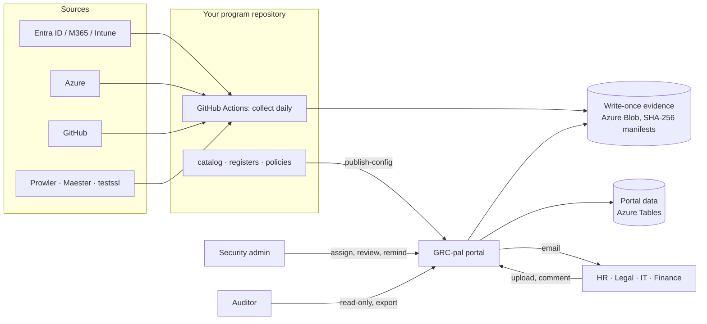

# GRC-pal

**Open-source SOC 2 compliance automation and evidence portal.** GRC-pal collects evidence
from your cloud and identity systems every day, keeps it in write-once storage, and gives
everyone else (HR, Legal, Finance, IT, your auditor) a simple web portal to see their controls,
upload evidence, discuss it and get reminders. It runs in your own cloud account for the cost
of a little storage.

- **77 controls** covering all 61 SOC 2 Trust Services Criteria (Security, Availability,
  Confidentiality, Processing Integrity, Privacy) and 285 points of focus, tagged to ISO 27001:2022
- **Multi-cloud collectors** for Microsoft Entra ID, Intune, Azure, AWS, Google Cloud and GitHub,
  plus Prowler, Maester and testssl.sh results
- **Multi-framework:** SOC 2 and ISO/IEC 27001:2022 built in; add any standard as a file or in the portal
- **Configuration page and Setup guide:** every connection explained, tested and saved in the browser
  (credentials encrypted)
- **Custom controls and checks:** manual controls for any framework, reference links, uploads, and
  scheduled HTTP or TLS checks that pull data and test the response
- **AI assistant:** per-control evidence review and full mock audits with Claude or your own model,
  always human-approved and kept as evidence
- **Logs page** with search for troubleshooting and audit
- **Evidence portal** with three roles, cycles, comments, email reminders, policy
  acknowledgments, admin overrides, auditor export and a tamper-evident audit log
- **Your data stays yours:** one instance per organization, Entra ID sign-in, no passwords stored,
  no third-party SaaS

License: [AGPL-3.0-or-later](LICENSE).

---

## Try it in one minute

```bash
pip install "grc-pal[portal] @ git+https://github.com/seattlespicybite/grc-pal"
grcpal serve --demo
```

Open http://localhost:8000 and pick a user: an admin, a Control owner (HR) or the external
auditor. The demo has a closed cycle, a carried-forward cycle with work in progress, comments,
a returned upload, an override and policy acknowledgments. Emails appear under **Email outbox**.

Prefer Docker? `docker compose up --build` does the same.

## What it does



| You need | GRC-pal gives you |
| --- | --- |
| A control library mapped to SOC 2 | `catalog/controls.yaml`, validated in CI, with coverage by criterion and point of focus |
| Continuous monitoring | Daily collectors and a control health dashboard (green, amber, red per control) |
| Evidence an auditor trusts | Write-once storage, SHA-256 manifests, full populations as CSV, code version per run |
| Work for people without GitHub | Portal requests with due dates, uploads (screenshots, PDFs, exports), review and comments |
| Follow-up | Email on assignment, upload, comment and review; a reminder button; weekly overdue reminders |
| Year two | Cycles: carry requests forward and see last cycle's evidence next to this cycle's |
| Audit fieldwork | Read-only auditor role and a one-click export zip per cycle with a SHA-256 manifest |
| Proof nobody edited history | Hash-chained audit log, verifiable in the UI and by `grcpal audit verify` |

## Roles

| Role | Can do |
| --- | --- |
| **Admin** | Everything: assign work, review evidence, override a control with justification and expiry, send reminders, manage users and cycles |
| **Control owner** | Sees only the controls assigned to them or owned by them; uploads evidence, comments, acknowledges policies |
| **Auditor** | Read-only: controls, evidence, comments, overrides, audit log, exports |

Details: [docs/roles.md](docs/roles.md).

## Deploy for your organization

1. **Create your program repository** from the starter kit:
   ```bash
   grcpal init acme-grc --org "Acme Inc"
   ```
   Edit `catalog/roles.yaml` (names and work emails) and `catalog/scope.yaml`, then push it to a
   private GitHub repository.
2. **Deploy to Azure** with one command (about 10 minutes):
   ```bash
   ./deploy/azure/deploy.sh --name acme --admins you@acme.com --github-repo acme/acme-grc
   ```
   It creates the storage account, the portal on Azure Container Apps behind Entra ID sign-in,
   logs, scheduled reminder jobs and a keyless identity for your repository's workflows.
3. **Sign in** at the URL it prints. Add people or just assign work; assignees get access automatically.

Step by step, including email and locking evidence retention: [docs/deploy-azure.md](docs/deploy-azure.md).

## Documentation

| | |
| --- | --- |
| [Quickstart](docs/quickstart.md) | Local trial, Docker, your own catalog |
| [Deploy to Azure](docs/deploy-azure.md) | Production deployment in plain steps |
| [Operations](docs/operations.md) | Daily and yearly routines, cycles, reminders, upgrades, backups |
| [Roles and permissions](docs/roles.md) | Exactly who can see and do what |
| [Configuration](docs/configuration.md) | Configuration page and every environment variable |
| [Clouds](docs/clouds.md) | Connecting Azure, AWS and Google Cloud with least privilege |
| [Frameworks, custom controls and checks](docs/frameworks-and-controls.md) | ISO 27001 and other standards, manual controls, URL checks |
| [AI assistant](docs/ai-assistant.md) | Evidence review and mock audits, data handling and risks |
| [Security](docs/security.md) | Threat model and built-in protections |
| [SaaS architecture](docs/saas-architecture.md) | Running GRC-pal for many organizations with strict data separation |
| [Compared with Vanta and Drata](docs/compare-and-roadmap.md) | What exists, what is planned |
| [Auditor guide](docs/auditor-guide.md) | How an auditor tests controls from GRC-pal evidence |
| [AI assist](docs/ai-assist.md) | Where AI helps the program, with guardrails |

## Command line

```
grcpal serve --demo            local portal with sample data
grcpal init DIR --org NAME     new program repository from the starter kit
grcpal validate                check catalog, registers and coverage
grcpal collect --all           run every enabled collector
grcpal report                  control health dashboard (HTML and JSON)
grcpal publish-config          send your catalog, registers and policies to the deployed portal
grcpal users add EMAIL --role admin
grcpal remind --overdue        email people with overdue requests
grcpal audit verify            verify the audit log hash chain
grcpal export --cycle ID       auditor export zip
grcpal checks run              run custom HTTP, TLS and command checks
grcpal ai review --control ID  AI evidence review of one control
grcpal ai audit --framework soc2   AI mock audit
```

## Contributing

Issues and pull requests are welcome. See [CONTRIBUTING.md](CONTRIBUTING.md). Report security
problems privately as described in [SECURITY.md](SECURITY.md).

The control descriptions and points of focus are short paraphrases written for navigation. The
AICPA Trust Services Criteria publication is authoritative. GRC-pal is not affiliated with the
AICPA, Microsoft, GitHub, Vanta or Drata.
