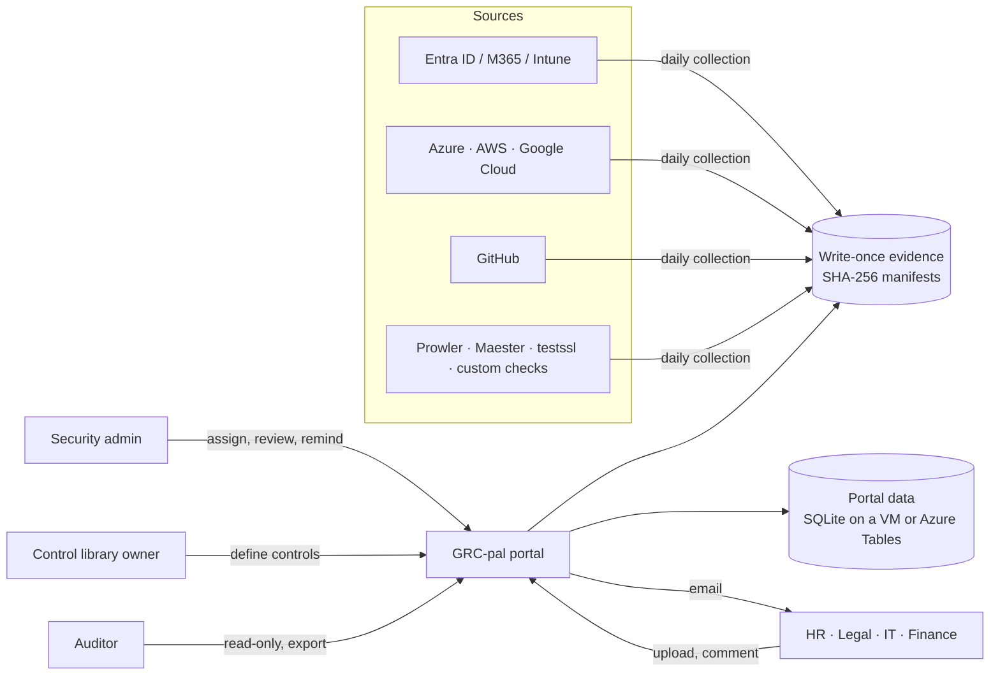

# GRC-pal

**Open-source SOC 2 compliance automation and evidence portal.** GRC-pal collects evidence from
your cloud and identity systems every day, keeps it in write-once storage, and gives everyone else
(HR, Legal, Finance, IT, your auditor) a simple web portal to see their controls, upload evidence,
discuss it and get reminders. You run it yourself: on a VM in your network, in Docker, or on Azure
for the cost of a little storage. No subscription, and your evidence never leaves your systems.

License: [AGPL-3.0-or-later](LICENSE).

## What's inside

- **Ready-made SOC 2 program:** 77 controls covering all 61 Trust Services Criteria (Security,
  Availability, Confidentiality, Processing Integrity, Privacy) and 285 points of focus, plus 18
  recurring activities (access reviews, DR test, risk assessment, tabletop, policy review...).
- **One framework at a time, or several:** turn on only what the organization works on. With only
  SOC 2 on, the portal is a SOC 2 tool. ISO/IEC 27001:2022 is built in; add any standard as a file
  or in the portal, and every control can count for several frameworks.
- **SOC 2 view:** criteria grouped into families (CC1-CC9, then Availability, Confidentiality,
  Processing Integrity, Privacy) with status per family, and criterion pages that show how each
  control is evidenced. Control pages remember where you came from (**Back to CC6.1**,
  previous/next control).
- **Daily automated evidence** from Microsoft Entra ID, Microsoft 365, Intune, Azure, AWS, Google
  Cloud and GitHub, plus Prowler, Maester and testssl.sh results, custom HTTP/TLS checks and an HR
  leavers export.
- **Evidence an auditor trusts:** write-once storage with SHA-256 manifests, full populations as
  CSV, a hash-chained audit log you can verify, and a one-click export per audit cycle.
- **Work for people without GitHub:** evidence requests with due dates, uploads, review with
  segregation of duties (nobody approves their own upload), comments, email reminders, policy
  acknowledgments and audit cycles that carry work into year two.
- **Control library owner:** one admin alone can change what a control is (owners, wording,
  evidence wanted, mappings). Every change needs a reason and is kept as a version for auditors.
- **Configuration in the browser:** a Setup guide and Configuration page that explain, test and
  save every connection; credentials are encrypted.
- **AI assistant (optional, off by default):** per-control evidence review and full mock audits
  with Claude or your own model, always approved by a person and kept as evidence.
- **Encrypted backups** of the whole instance in one verifiable file.

## Try it in one minute

```bash
pip install "grc-pal[portal] @ git+https://github.com/seattlespicybite/grc-pal"
grcpal serve --demo
```

Open http://localhost:8000 and pick a user: an admin (Alex is also the control library owner), a
Control owner (Harper from HR) or the external auditor (Casey). The demo has a closed cycle, work
in progress, comments, a returned upload, an override and policy acknowledgments. Emails appear
under **Email outbox**. Demo data lives in memory, so a restart starts fresh.

On Windows, use `py -m pip install ...` inside a virtual environment. Prefer Docker?
`docker compose up --build` runs the same demo and keeps its data in a volume.

The demo uses simulated sign-in (anyone can act as anyone), so never expose it to a network.

## How it works



| You need | GRC-pal gives you |
| --- | --- |
| A control library mapped to SOC 2 | 77 controls with coverage by criterion and point of focus, editable in the portal by the control library owner |
| Continuous monitoring | Daily collectors and a control health dashboard (operating, findings, needs attention, not started) |
| Evidence an auditor trusts | Write-once storage, SHA-256 manifests, full populations, code version per run |
| Work for people without GitHub | Requests with due dates, uploads (screenshots, PDFs, exports), review and comments; admins can change people and due dates at any time |
| Follow-up | Email on assignment, upload, comment and review; a reminder button; weekly overdue reminders |
| Recurring activities | Access reviews, DR tests, risk assessments and more open as requests in the right month |
| Year two | Cycles: carry requests forward and see last cycle's evidence next to this cycle's |
| Audit fieldwork | Read-only auditor accounts with an end date, and an export zip per cycle with a SHA-256 manifest and every control change |
| Proof nobody edited history | Hash-chained audit log, verifiable in the portal and with `grcpal audit verify` |

## Roles

| Role | Can do |
| --- | --- |
| **Admin** | Runs the program: assign and change requests, review evidence (never their own upload), override a control with justification and expiry, send reminders, manage users, cycles, frameworks in use and connections |
| **Control library owner** | One admin (can be the same person) who alone changes control definitions: owners, title, description, evidence wanted, framework mappings, custom controls and custom frameworks |
| **Control owner** | Sees only the controls assigned to them or owned by them; uploads evidence, comments, acknowledges policies |
| **Auditor** | Read-only: controls, evidence, comments, overrides, control history, audit log, exports; access ends on a set date |

Every rule is enforced on the server and every change is in the audit log. Details:
[docs/roles.md](docs/roles.md).

## Deploy for your organization

Choose where it runs. Every option keeps the data in your own systems.

| | VM in your network | Docker | Azure Container Apps |
| --- | --- | --- | --- |
| Best for | Most teams; consultants running one client's program | Teams that already run containers | Teams on Azure who want Entra ID single sign-on |
| Sign-in | GRC-pal accounts (email and password) | GRC-pal accounts | Entra ID (Microsoft sign-in, Conditional Access, MFA) |
| Data | SQLite file and evidence folder on the VM | A Docker volume | Azure Tables and Blob storage |
| Scheduled jobs | cron | cron on the host | Created by the template |
| Guide | [quickstart.md, section 4](docs/quickstart.md#4-on-a-vm-for-your-team-production-local-accounts) | [same section, option B](docs/quickstart.md#option-b-docker) | [deploy-azure.md](docs/deploy-azure.md) |

### VM (Python), in short

```bash
python3 -m venv /var/lib/grcpal/venv
/var/lib/grcpal/venv/bin/pip install "grc-pal[portal] @ git+https://github.com/seattlespicybite/grc-pal@main"
# /etc/grcpal.env: GRCPAL_ENV=production, GRCPAL_SECRET, GRCPAL_ENCRYPTION_KEY, GRCPAL_PUBLIC_URL,
#                  GRCPAL_SQLITE and GRCPAL_EVIDENCE_DIR (see the guide)
grcpal create-admin you@example.com --name "Your Name"     # asks for the password twice
uvicorn grcpal.portal.app:app --host 127.0.0.1 --port 8000 --proxy-headers   # as a systemd service
```

Put it behind HTTPS (Caddy, nginx or IIS with your certificate) and add the cron jobs for daily
collection, monthly recurring activities, weekly reminders and nightly backups. The guide has the
complete service file, settings file and crontab.

### Docker, in short

```bash
docker build -t grc-pal .
docker run -d --name grcpal --restart unless-stopped -p 127.0.0.1:8000:8000 \
  -v grcpal-data:/data --read-only --tmpfs /tmp --cap-drop ALL --security-opt no-new-privileges \
  -e GRCPAL_PUBLIC_URL=https://grc.internal.example.com \
  -e GRCPAL_SQLITE=/data/grcpal.db -e GRCPAL_EVIDENCE_DIR=/data/evidence \
  --env-file /etc/grcpal.secrets grc-pal
docker exec -it grcpal grcpal create-admin you@example.com --name "Your Name"
```

The image runs as a non-root user in production mode with local accounts. `/etc/grcpal.secrets`
holds `GRCPAL_SECRET` and `GRCPAL_ENCRYPTION_KEY`.

### Azure, in short

```bash
grcpal init acme-grc --org "Acme Inc"     # your program repository; push it to a private GitHub repo
./deploy/azure/deploy.sh --name acme --admins you@acme.com --github-repo acme/acme-grc
```

About 10 minutes. It creates the storage account, the portal on Azure Container Apps behind Entra
ID sign-in, logs, scheduled jobs and a keyless identity for your repository's workflows.

### After deploying (any option)

1. **Users and roles:** add people (local accounts get a one-time link to choose a password) and
   make one admin the **control library owner**.
2. **Frameworks:** keep only the frameworks the organization is working on (for example SOC 2).
3. **Setup guide:** connect Microsoft Entra ID / Microsoft 365, Azure, GitHub and email. Each
   connection is tested before it is saved. Turn off what is not used (AWS, Google Cloud).
4. **Controls:** as library owner, adjust owners and wording to the organization; each change asks
   for a reason and is kept for the auditor.
5. **Requests:** assign evidence requests, or let the recurring activities open them each month.
6. **Backups:** confirm the nightly backup runs and copies leave the server.

### Security notes

- **Local accounts have no MFA or lockout yet.** Use them only on a portal reachable from your
  internal network or VPN, always behind HTTPS. For anything wider, use Entra ID sign-in (Azure)
  or an identity-aware proxy (`GRCPAL_AUTH_MODE=proxy`). See [docs/security.md](docs/security.md).
- `GRCPAL_ENV=production` refuses the demo's simulated sign-in and requires the secrets above.
- Keep `GRCPAL_ENCRYPTION_KEY` and the backup key in a password manager, apart from the backups.
- Report vulnerabilities privately as described in [SECURITY.md](SECURITY.md).

## Upgrades and backups

- **Back up** with `grcpal backup create FILE --key-file KEY`: one encrypted, tamper-evident file
  with every table, all evidence and the configuration. `grcpal backup verify` proves it is complete.
  Restoring into a clean instance is the next item on the roadmap.
- **Upgrade** after a backup: reinstall the package or rebuild the image and restart. Upgrades
  never rewrite stored evidence, and control edits made by the library owner are kept; if a
  release changes the starter text of a control you edited, the control page tells you.
- Read the [CHANGELOG](CHANGELOG.md) before upgrading. Details: [docs/operations.md](docs/operations.md).

## Documentation

| | |
| --- | --- |
| [Quickstart](docs/quickstart.md) | Local trial, Docker, your own catalog, production VM with Python or Docker |
| [Deploy to Azure](docs/deploy-azure.md) | Azure Container Apps with Entra ID sign-in |
| [Operations](docs/operations.md) | Daily and yearly routines, cycles, reminders, logs, backups, upgrades |
| [Roles and permissions](docs/roles.md) | Exactly who can see and do what, including the control library owner |
| [Frameworks, controls and checks](docs/frameworks-and-controls.md) | Frameworks in use, the SOC 2 view, editing controls, custom controls, URL checks |
| [Configuration](docs/configuration.md) | Configuration page and every environment variable |
| [Clouds](docs/clouds.md) | Connecting Azure, AWS and Google Cloud with least privilege |
| [AI assistant](docs/ai-assistant.md) | Evidence review and mock audits, data handling and risks |
| [Security](docs/security.md) | Threat model, built-in protections, accepted risks |
| [Auditor guide](docs/auditor-guide.md) | How an auditor tests controls from GRC-pal evidence |
| [SaaS architecture](docs/saas-architecture.md) | Running GRC-pal for many organizations with strict data separation |
| [Compared with Vanta and Drata](docs/compare-and-roadmap.md) | What exists, what is planned |
| [AI assist](docs/ai-assist.md) | Where AI helps the program, with guardrails |

## Command line

```
grcpal serve --demo                     local portal with sample data
grcpal serve --db grcpal.db             local portal that keeps its data
grcpal init DIR --org NAME              new program repository from the starter kit
grcpal validate                         check catalog, registers and coverage
grcpal collect --all [--checks]         run every enabled collector (and due custom checks)
grcpal tasks                            open this month's recurring activities as requests
grcpal report                           control health dashboard (HTML and JSON)
grcpal store --source NAME FILES        add result files (Prowler, Maester, ...) as evidence
grcpal checks run                       run custom HTTP, TLS and command checks now
grcpal publish-config                   send your catalog, registers and policies to the portal
grcpal create-admin EMAIL               first admin, or break-glass admin (local sign-in)
grcpal users list                       list portal users
grcpal users add EMAIL --role admin     add a user (admin, contributor = Control owner, auditor)
grcpal remind --overdue                 email people with overdue requests
grcpal audit verify                     verify the audit log hash chain
grcpal export --cycle ID                auditor export zip
grcpal backup keygen | create FILE | verify FILE   encrypted whole-instance backup
grcpal ai review --control ID           AI evidence review of one control
grcpal ai audit --framework soc2        AI mock audit
```

Commands that touch the portal read the same settings as the portal (`GRCPAL_SQLITE` or
`GRCPAL_TABLES_URL`, and the connections and email settings saved on the Configuration page).

## Contributing

Issues and pull requests are welcome. See [CONTRIBUTING.md](CONTRIBUTING.md). Report security
problems privately as described in [SECURITY.md](SECURITY.md).

The control descriptions, criterion titles and points of focus are short paraphrases written for
navigation. The AICPA Trust Services Criteria publication is authoritative. GRC-pal is not
affiliated with the AICPA, Microsoft, GitHub, Vanta or Drata.
