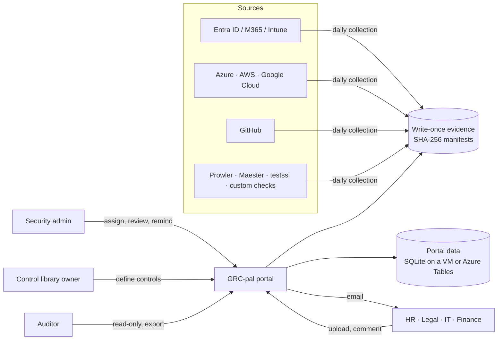

# GRC-pal

**Open-source SOC 2 compliance automation and evidence portal.** GRC-pal collects evidence from
your cloud and identity systems every day, keeps it in write-once storage, and gives everyone else
(HR, Legal, Finance, IT, your auditor) a simple web portal to see their controls, upload evidence,
discuss it and get reminders. You run it yourself: on a VM in your network, in Docker, or on Azure
for the cost of a little storage. No subscription, and your evidence never leaves your systems.

License: [AGPL-3.0-or-later](LICENSE).

## What's inside

- **Ready-made SOC 2 Type 2 program:** 77 controls covering all 61 Trust Services Criteria and 285
  points of focus, plus 40 recurring activities (access reviews, DR test, risk assessment, tabletop,
  policy review...). The starter scope is Security, Availability and Confidentiality; Processing
  Integrity and Privacy are ready but deferred, and their controls stay out of the way until you
  add them to scope.
- **SOC 2 first:** a new installation works on SOC 2 only. ISO/IEC 27001:2022 is built in and keeps
  its mappings: an admin can turn it on per organization to see how far the SOC 2 controls already
  go. Any other standard can be added as a file or in the portal.
- **Knowledge base:** evidence guidance for every Security, Availability and Confidentiality
  criterion and point of focus: what the auditor tests, what good evidence looks like, good
  examples, common mistakes and how often. Linked from controls, criteria and evidence requests.
- **How we meet this control:** implementation notes on each control (for example "Covered by
  InfoSec Policy section 6; DR test every November"), versioned and audit-logged, so the next
  person inherits the program and the auditor gets your narrative in the export.
- **SOC 2 view:** criteria grouped into families (CC1-CC9, then Availability, Confidentiality,
  Processing Integrity, Privacy) with status per family, and criterion pages that show how each
  control is evidenced. Control pages remember where you came from (**Back to CC6.1**,
  previous/next control).
- **Daily automated evidence** from Microsoft Entra ID, Microsoft 365, Intune, Azure, AWS, Google
  Cloud and GitHub, plus Prowler, Maester and testssl.sh results, custom HTTP/TLS checks and an HR
  leavers export.
- **Evidence an auditor trusts:** write-once storage with SHA-256 manifests, full populations as
  CSV, a hash-chained audit log you can verify, and a one-click export per audit cycle.
- **Work for people without GitHub:** evidence requests with due dates, uploads, review with
  segregation of duties (nobody approves their own upload), comments, email reminders, policy
  acknowledgments and audit cycles that carry work into year two.
- **Control library owner:** one admin alone can change what a control is (owners, wording,
  evidence wanted, mappings). Every change needs a reason and is kept as a version for auditors.
- **Configuration in the browser:** a Setup guide and Configuration page that explain, test and
  save every connection; credentials are encrypted.
- **AI assistant (optional, off by default):** per-control evidence review and full mock audits
  with Claude or your own model, always approved by a person and kept as evidence.
- **Security calendar:** one year page with every recurring activity and automated check, editable
  by admins. Nothing is marked missed automatically: an admin records Performed or Missed, and every
  decision is kept for the auditor.
- **Backups and safe updates:** nightly encrypted, verifiable backups of the whole instance with a
  recovery kit; updates are backed up, tried on a copy of the data, health-checked and rolled back by
  themselves if a check fails. Both have admin pages (**Backups**, **Updates**).

## Try it in one minute

```bash
pip install "grc-pal[portal] @ git+https://github.com/seattlespicybite/grc-pal"
grcpal serve --demo
```

Open http://localhost:8000 and pick a user: an admin (Alex is also the control library owner), a
Control owner (Harper from HR) or the external auditor (Casey). The demo has a closed cycle, work
in progress, comments, a returned upload, an override and policy acknowledgments. Emails appear
under **Email outbox**. Demo data lives in memory, so a restart starts fresh.

On Windows, use `py -m pip install ...` inside a virtual environment. Prefer Docker?
`docker compose up --build` runs the same demo and keeps its data in a volume.

The demo uses simulated sign-in (anyone can act as anyone), so never expose it to a network.

## How it works



| You need | GRC-pal gives you |
| --- | --- |
| A control library mapped to SOC 2 | 77 controls with coverage by criterion and point of focus, editable in the portal by the control library owner |
| Continuous monitoring | Daily collectors and a control health dashboard (operating, findings, needs attention, not started) |
| Evidence an auditor trusts | Write-once storage, SHA-256 manifests, full populations, code version per run |
| Work for people without GitHub | Requests with due dates, uploads (screenshots, PDFs, exports), review and comments; admins can change people and due dates at any time |
| Follow-up | Email on assignment, upload, comment and review; a reminder button; weekly overdue reminders |
| Recurring activities | Access reviews, DR tests, risk assessments and more on a security calendar; they open as requests in the right month |
| Year two | Cycles: carry requests forward and see last cycle's evidence next to this cycle's |
| Audit fieldwork | Read-only auditor accounts with an end date, and an export zip per cycle with a SHA-256 manifest and every control change |
| Proof nobody edited history | Hash-chained audit log, verifiable in the portal and with `grcpal audit verify` |

## Roles

| Role | Can do |
| --- | --- |
| **Admin** | Runs the program: assign and change requests, review evidence (never their own upload), override a control with justification and expiry, send reminders, manage users, cycles, frameworks in use and connections |
| **Control library owner** | One admin (can be the same person) who alone changes control definitions: owners, title, description, evidence wanted, framework mappings, custom controls and custom frameworks |
| **Control owner** | Sees only the controls assigned to them or owned by them; uploads evidence, comments, acknowledges policies |
| **Auditor** | Read-only: controls, evidence, comments, overrides, control history, audit log, exports; access ends on a set date |

Every rule is enforced on the server and every change is in the audit log. Details:
[docs/roles.md](docs/roles.md).

## Deploy for your organization

Two supported ways to run it. Both keep the data in your own systems, back up every night, and update
without risking data: each update is backed up, tried on a copy of the data, checked, and rolled back by
itself if a check fails.

| | VM in your network | Azure Container Apps |
| --- | --- | --- |
| Best for | Privacy: everything stays on your network (staff on site or on VPN) | Remote staff; MSPs and vCISOs (one instance per client) |
| Runs on | Debian 13 minimal + Docker, one install script | Your Azure subscription, one deploy script |
| Sign-in | GRC-pal accounts (email and password) | Entra ID (MFA, Conditional Access, compliant devices) |
| Data | One folder on the VM | Azure Tables and write-once Blob storage |
| Backups | Nightly to the VM, plus your network share; Backups page | Nightly to a write-once container; Backups page |
| Updates | Signed update files (no internet needed); every update waits for Approve, with a live progress bar | Workflow in your program repository, run with the version; new version checked before it gets traffic |
| Guide | [deploy-vm.md](docs/deploy-vm.md) | [deploy-azure.md](docs/deploy-azure.md) |

### VM, in short

```bash
sudo ./install.sh --hostname grc.internal.example.com --version 0.3.0   # from the release's installer kit
sudo grcpal create-admin you@example.com --name "Your Name"
```

It installs Docker, Caddy (HTTPS), a firewall and automatic security updates, then GRC-pal with its
scheduled jobs, nightly backups and the updater. Then open Administration → Backups and download the
recovery kit.

### Azure, in short

```bash
grcpal init acme-grc --org "Acme Inc"     # your program repository; push it to a private GitHub repo
./deploy/azure/deploy.sh --name acme --admins you@acme.com --github-repo acme/acme-grc
```

About 10 minutes. It creates the storage account, the portal on Azure Container Apps behind Entra
ID sign-in, logs, scheduled jobs (including backups), and keyless identities for your repository's
collector and update workflows.

The Python install (`pip install`, `grcpal serve`) and Docker Compose are for trying GRC-pal and for
development only.

### After deploying (any option)

1. **Users and roles:** add people (local accounts get a one-time link to choose a password) and
   make one admin the **control library owner**.
2. **Scope and frameworks:** SOC 2 is the only framework in use by default; set the report scope in
   `catalog/scope.yaml` (starter: Security, Availability, Confidentiality).
3. **Setup guide:** connect Microsoft Entra ID / Microsoft 365, Azure, GitHub and email. Each
   connection is tested before it is saved. Turn off what is not used (AWS, Google Cloud).
4. **Controls:** as library owner, adjust owners and wording to the organization; each change asks
   for a reason and is kept for the auditor.
5. **Requests:** assign evidence requests, or let the recurring activities open them each month.
6. **Backups:** confirm the nightly backup runs and copies leave the server.

### Security notes

- **Local accounts have no MFA or lockout yet.** Use them only on a portal reachable from your
  internal network or VPN, always behind HTTPS. For anything wider, use Entra ID sign-in (Azure)
  or an identity-aware proxy (`GRCPAL_AUTH_MODE=proxy`). See [docs/security.md](docs/security.md).
- `GRCPAL_ENV=production` refuses the demo's simulated sign-in and requires the secrets above.
- Keep `GRCPAL_ENCRYPTION_KEY` and the backup key in a password manager, apart from the backups.
- Report vulnerabilities privately as described in [SECURITY.md](SECURITY.md).

## Quick guide: deploy, back up, update

> **Release status:** the VM installer and the updaters install published releases (0.3.0 and later).
> Until 0.3.0 is on the [releases page](https://github.com/seattlespicybite/grc-pal/releases), use the
> demo above to evaluate; production installs start with that release.

**1. Deploy** (once)

| | VM in your network | Azure |
| --- | --- | --- |
| Install | `sudo ./install.sh --hostname grc.example.com --version 0.3.0` | `./deploy/azure/deploy.sh --name acme --admins you@acme.com --github-repo acme/acme-grc` |
| First admin | `sudo grcpal create-admin you@example.com` | the `--admins` emails |
| Lock down | VPN or internal network only (local accounts have no MFA yet) | Conditional Access: MFA and compliant devices ([Step 3b](docs/deploy-azure.md#step-3b-allow-only-your-staff-on-managed-devices-conditional-access)) |

**2. Back up** (set once, then check monthly)

1. Sign in, open **Administration → Backups** and **download the recovery kit**. Store it in a password
   manager, never next to the backups. Without it no backup can be read.
2. The nightly backup is on by default (02:00 UTC). On a VM, add a second location outside the VM (network
   share, `GRCPAL_BACKUP_DIR_2_HOST`); on Azure, backups are write-once for 35 days.
3. Each backup is checked right after it is written. **Check** re-verifies one at any time.
4. Once a year, do a restore test and keep the result as SOC 2 A1.3 evidence
   ([how](docs/operations.md#yearly-restore-test)).

Command line, any install: `grcpal backup create FILE`, `grcpal backup verify FILE`,
`grcpal backup restore FILE --kit recovery-kit.json` (fills only an empty instance or a new folder).

**3. Update** (you decide when)

| | VM | Azure |
| --- | --- | --- |
| See what is available | **Administration → Updates**: newer releases, each with *Do I need it?* | Same page, or the weekly run summary of the **GRC-pal update** workflow |
| Install (fixes or features) | **Administration → Updates → Approve**; the page shows each step and its percentage | Actions → **GRC-pal update** → Run workflow with the version; the log shows each step and its percentage |
| No internet | `sudo grcpal-update apply grcpal-<version>.grcupdate` (signed file) | n/a |
| Go back | `sudo grcpal-update rollback` | Run the workflow with **rollback** |

Every update makes a backup first, tries the new version on a copy of your data, checks the portal, the
data model, audit chains and evidence hashes, and rolls back by itself if anything fails. Evidence is never
changed by an update. Details: [deploy-vm.md](docs/deploy-vm.md#updates),
[deploy-azure.md](docs/deploy-azure.md#updates), [operations.md](docs/operations.md#upgrades).

## Documentation

| | |
| --- | --- |
| [Quickstart](docs/quickstart.md) | Local trial, Docker, your own catalog, where to go for production |
| [Deploy on a VM](docs/deploy-vm.md) | Debian 13 + Docker in your network: install, backups, signed updates, rebuild |
| [Deploy to Azure](docs/deploy-azure.md) | Azure Container Apps with Entra ID sign-in, Conditional Access, backups, updates |
| [Operations](docs/operations.md) | Daily and yearly routines, cycles, reminders, logs, backups, restore tests, disaster recovery, upgrades |
| [Roles and permissions](docs/roles.md) | Exactly who can see and do what, including the control library owner |
| [Frameworks, controls and checks](docs/frameworks-and-controls.md) | Frameworks in use, the SOC 2 view, implementation notes, the knowledge base, editing controls, custom controls, URL checks |
| [Configuration](docs/configuration.md) | Configuration page and every environment variable |
| [Clouds](docs/clouds.md) | Connecting Azure, AWS and Google Cloud with least privilege |
| [AI assistant](docs/ai-assistant.md) | Evidence review and mock audits, data handling and risks |
| [Security](docs/security.md) | Threat model, built-in protections, accepted risks |
| [Auditor guide](docs/auditor-guide.md) | How an auditor tests controls from GRC-pal evidence |
| [SaaS architecture](docs/saas-architecture.md) | Running GRC-pal for many organizations with strict data separation |
| [Compared with Vanta and Drata](docs/compare-and-roadmap.md) | What exists, what is planned |
| [AI assist](docs/ai-assist.md) | Where AI helps the program, with guardrails |

## Command line

```
grcpal serve --demo                     local portal with sample data
grcpal serve --db grcpal.db             local portal that keeps its data
grcpal init DIR --org NAME              new program repository from the starter kit
grcpal validate                         check catalog, registers and coverage
grcpal collect --all [--checks]         run every enabled collector (and due custom checks)
grcpal tasks                            open this month's recurring activities as requests
grcpal report                           control health dashboard (HTML and JSON)
grcpal store --source NAME FILES        add result files (Prowler, Maester, ...) as evidence
grcpal checks run                       run custom HTTP, TLS and command checks now
grcpal publish-config                   send your catalog, registers and policies to the portal
grcpal create-admin EMAIL               first admin, or break-glass admin (local sign-in)
grcpal users list                       list portal users
grcpal users add EMAIL --role admin     add a user (admin, contributor = Control owner, auditor)
grcpal remind --overdue                 email people with overdue requests
grcpal audit verify                     verify the audit log hash chain
grcpal export --cycle ID                auditor export zip
grcpal backup keygen | kit --out FILE    backup key; recovery kit for a password manager
grcpal backup create FILE | verify FILE  encrypted whole-instance backup and its check
grcpal backup restore FILE --kit KIT     rebuild an empty instance (or --into a new folder)
grcpal backup run-due                   scheduled and queued backups (run hourly by the VM timer or Azure job)
grcpal migrate [--check]                data model version and pending migrations
sudo grcpal-update status | apply FILE | rollback   VM updater (on the host)
grcpal ai review --control ID           AI evidence review of one control
grcpal ai audit --framework soc2        AI mock audit
```

Commands that touch the portal read the same settings as the portal (`GRCPAL_SQLITE` or
`GRCPAL_TABLES_URL`, and the connections and email settings saved on the Configuration page).

## Contributing

Issues and pull requests are welcome. See [CONTRIBUTING.md](CONTRIBUTING.md). Report security
problems privately as described in [SECURITY.md](SECURITY.md).

The control descriptions, criterion titles and points of focus are short paraphrases written for
navigation. The AICPA Trust Services Criteria publication is authoritative. GRC-pal is not
affiliated with the AICPA, Microsoft, GitHub, Vanta or Drata.
