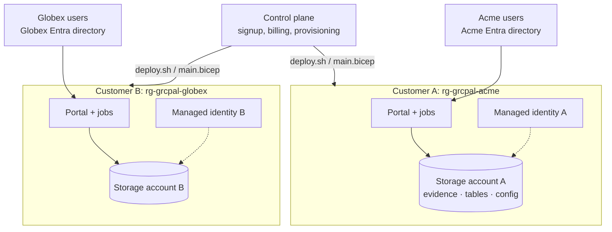

# Running GRC-pal for many organizations (SaaS)

GRC-pal is built so it can later be offered as a hosted subscription where each customer gets
their own instance. Customer data separation is the first design constraint.

## Isolation model: one silo per customer

Each customer has its own resource group, Container App, storage account, managed identity,
sign-in registration and log workspace. Identity A has no role on storage B, so even a code bug
cannot read across customers: Azure refuses the request.

## Defense in depth inside each instance

Silos are the boundary. The application adds its own layers in case two tenants ever share a
backend (by mistake, or in a future pooled tier):

| Layer | Mechanism | Tested by |
| --- | --- | --- |
| Data access | Application code only receives a `TenantStore`. Every partition key is written as `<tenant>|<key>`, every query is restricted to that prefix, and any row without the prefix raises `PermissionError` instead of being returned | `test_tenant_isolation_store_and_evidence` |
| Evidence | Every blob path is `<tenant>/<source>/<run>/...`. Callers only ever handle `<source>/<run>`; path separators and `..` are rejected | same test |
| Configuration | The published catalog bundle lives at `config/<tenant>/program.tar.gz`; extraction accepts only regular files under `catalog/`, `registers/`, `policies/` | `test_config_bundle_extract_is_safe` |
| Sign-in | `GRCPAL_ALLOWED_TENANT_IDS` accepts only the customer's Entra directory; users must exist in that instance's users table | `test_easyauth_identity_tenant_allow_list`, `test_provisioning_rules` |
| Audit | Each instance has its own hash chain; an operator action in one tenant cannot appear in another's chain | tenant test verifies both chains |
| Logs | Every log line carries the tenant ID | |

Tenant IDs are validated (`^[a-z0-9][a-z0-9-]{0,39}$`) so they cannot inject separators.

## Provisioning a customer

The control plane (not part of this repository yet) would, per signup:

1. choose a tenant ID (`acme`) and region;
2. create an app registration in the **provider's** directory configured as multi-tenant, or ask
   the customer's admin to create one in theirs (simplest, and keeps their sign-in policies);
3. run `main.bicep` with `instanceName=acme`, `allowedTenantIds=<customer directory ID>`,
   `bootstrapAdmins=<customer admin>`;
4. hand the customer the URL. Their admin signs in and adds their people.

Offboarding: export every cycle for the customer, then delete the resource group. Locked evidence
remains until retention ends; agree in the contract who holds it and for how long.

## Costs per customer

Scale-to-zero Container Apps and storage keep an idle customer in the low single dollars per
month; the Log Analytics daily cap bounds logging. Measure with real usage before pricing.

## Why not a shared (pooled) database first

A pooled design is cheaper at large scale but makes every query a potential leak and complicates
customer-specific retention, region and deletion. Silos match how SOC 2 customers ask questions
("where exactly is our data, who can access it") and keep GRC-pal's own SOC 2 scope simple. The
`TenantStore` layer keeps the door open for a pooled tier for very small customers later.

## Licensing note

GRC-pal is AGPL-3.0. Anyone may run it as a service, including you; if they modify it and offer
it to users over a network, they must offer those users the modified source. Customers' own
catalogs, policies and evidence are their data, not part of the program. If you plan to offer
commercial licenses alongside AGPL, require contributors to sign a contributor license agreement
before accepting outside code (see CONTRIBUTING.md). Get legal advice before selling.
